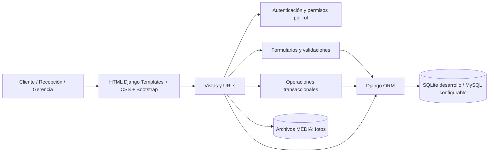
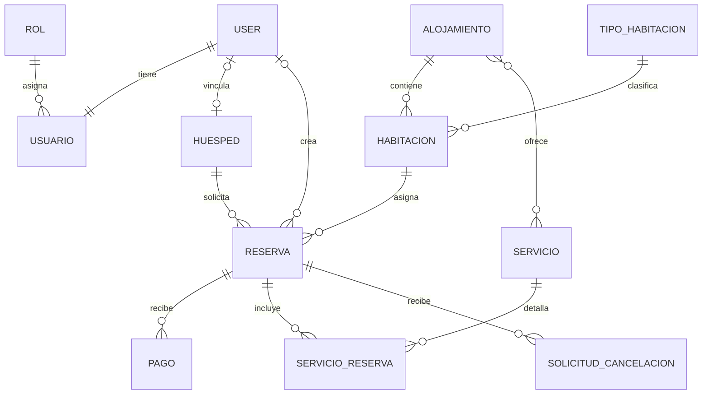

# Análisis y diseño del proyecto SysHSENA

**Sistema Web Integral para la Gestión de Alojamientos, Reservas y Servicios Turísticos de La Guajira**  
**Versión:** 1.0  
**Tecnologías:** Python, Django, Django ORM, SQLite para desarrollo y MySQL configurable para despliegue, HTML5, CSS3 y Bootstrap.

## 1. Contexto y situación problema

Pequeños hoteles, hostales y posadas pueden gestionar sus habitaciones,
reservas, huéspedes, pagos y servicios mediante registros separados. Esto
facilita errores de digitación, reservas simultáneas, pérdida de trazabilidad y
dificultad para conocer los saldos, los ingresos y la ocupación.

SysHSENA centraliza esa información en una aplicación web con acceso por roles,
validaciones de negocio y reportes para apoyar la operación de alojamientos de
La Guajira.

## 2. Justificación

El proyecto aplica análisis de requerimientos, modelado de datos, programación
orientada a objetos, desarrollo web con Django, autenticación, permisos,
persistencia mediante ORM, pruebas y documentación. La configuración regional
incluye municipio, información turística, servicios y fotografías del
establecimiento.

## 3. Objetivos

### Objetivo general

Desarrollar un sistema web integral para administrar alojamientos, habitaciones,
huéspedes, reservas, disponibilidad, servicios y pagos de establecimientos
turísticos de La Guajira.

### Objetivos específicos

- Identificar actores, necesidades y reglas de la operación hotelera.
- Diseñar entidades y relaciones que preserven la integridad de la información.
- Implementar acceso por roles y operaciones protegidas.
- Gestionar disponibilidad, reservas, check-in, check-out, pagos y servicios.
- Proveer indicadores, reportes y manuales para el uso y mantenimiento.
- Verificar los flujos principales mediante pruebas automatizadas.

## 4. Alcance y actores

El sistema administra usuarios y roles, alojamiento, tipos y habitaciones,
huéspedes, reservas, solicitudes de cancelación, pagos, servicios, reportes y
dashboard. No integra pasarelas de pago, facturación electrónica ni canales de
reservas externos.

| Actor | Responsabilidades principales |
|---|---|
| Administrador | Administra usuarios, roles, alojamiento, tipos, habitaciones y servicios; consulta reservas, huéspedes, pagos y reportes. |
| Recepcionista | Registra huéspedes y reservas, confirma, modifica y cancela reservas, agrega servicios, registra pagos y realiza check-in/check-out. |
| Gerente | Consulta dashboard, reservas, pagos e informes para supervisar la operación. |
| Cliente | Se registra, consulta disponibilidad, solicita reservas, elige servicios adicionales y consulta su historial o solicita una cancelación. |

## 5. Requerimientos funcionales

| Código | Requerimiento | Implementación |
|---|---|---|
| RF-001 | Registrar usuarios y huéspedes. | Registro de clientes y administración de usuarios/huéspedes. |
| RF-002 | Autenticar y cerrar sesión. | Autenticación de Django y cierre de sesión protegido por POST. |
| RF-003 | Administrar habitaciones. | CRUD, tipo, capacidad, tarifa, estado e imagen. |
| RF-004 | Consultar disponibilidad. | Filtro por estado, fechas y capacidad; se excluyen cruces activos y mantenimiento. |
| RF-005 | Registrar reservas. | Flujos del cliente y recepción, con usuario, huésped, habitación y fechas. |
| RF-006 | Impedir conflictos de fechas. | Validación de formulario y control transaccional al guardar. |
| RF-007 | Registrar y consultar huéspedes. | CRUD de huéspedes e historial relacionado con reservas. |
| RF-008 | Registrar pagos y abonos. | Formulario, métodos de pago, referencia, validación de saldo e historial. |
| RF-009 | Realizar check-in. | Solo sobre reservas confirmadas; registra fecha y cambia el estado operativo. |
| RF-010 | Realizar check-out. | Solo tras el check-in; finaliza la reserva y sincroniza la habitación. |
| RF-011 | Registrar servicios adicionales. | Catálogo de servicios y asociación con cantidad y precio histórico a una reserva. |
| RF-012 | Generar reportes. | Reservas, ingresos, ocupación, huéspedes e indicadores de servicios vendidos. |

## 6. Requerimientos no funcionales

| Código | Criterio | Evidencia |
|---|---|---|
| RNF-001 | Seguridad | Autenticación, permisos por rol, protección CSRF, validación de formularios y configuración por variables de entorno. |
| RNF-002 | Usabilidad | Etiquetas en formularios, mensajes, navegación en español y flujos separados por actor. |
| RNF-003 | Responsive | Plantillas adaptables, grillas flexibles y contenedores desplazables para tablas. |
| RNF-004 | Integridad | Relaciones FK/OneToOne/M2M, restricciones únicas y operaciones atómicas para reservas. |
| RNF-005 | Rendimiento | `select_related`, `prefetch_related`, agregaciones y paginación en listados. |
| RNF-006 | Mantenibilidad | Separación entre modelos, formularios, vistas, operaciones, permisos, plantillas y migraciones. |
| RNF-007 | Control de versiones | Repositorio Git local; publicar en GitHub requiere configurar un remoto autorizado. |

## 7. Historias de usuario

1. **Como administrador**, quiero configurar el alojamiento y subir una foto,
   para que sus datos e imagen aparezcan en la página pública.
2. **Como administrador**, quiero crear habitaciones con tipo, capacidad,
   precio, estado y fotografía, para mantener el catálogo actualizado.
3. **Como recepcionista**, quiero registrar una reserva sin cruces de fechas,
   para evitar asignar la misma habitación dos veces.
4. **Como recepcionista**, quiero confirmar una reserva y registrar llegada y
   salida, para controlar el estado operativo de la habitación.
5. **Como cliente**, quiero consultar habitaciones disponibles para mis fechas,
   para seleccionar una opción que admita a mis huéspedes.
6. **Como cliente**, quiero añadir servicios al solicitar una habitación, para
   conocer los cargos adicionales de mi reserva.
7. **Como recepcionista**, quiero registrar abonos sin superar el saldo, para
   mantener el estado financiero correcto.
8. **Como gerente**, quiero consultar ingresos, ocupación, reservas y huéspedes,
   para entender el desempeño del establecimiento.

## 8. Casos de uso

### CU-01: Solicitar una reserva

- **Actor principal:** Cliente autenticado.
- **Precondiciones:** Existe un perfil de huésped y una habitación disponible.
- **Flujo:** El cliente selecciona habitación, fechas, cantidad de huéspedes y
  servicios opcionales; el sistema valida fechas, capacidad, estado y conflictos;
  crea la reserva, congela la tarifa y asocia los servicios con sus precios.
- **Alternativas:** Si la habitación no está disponible o los datos no son
  válidos, el sistema muestra el error y no conserva una reserva incompleta.
- **Resultado:** Reserva pendiente asociada al huésped y a los servicios.

### CU-02: Registrar un pago

- **Actor principal:** Administrador o recepcionista.
- **Precondiciones:** Existe una reserva con saldo pendiente.
- **Flujo:** Selecciona la reserva, indica valor, método y referencia opcional;
  el sistema valida que el abono sea positivo y no exceda el saldo; guarda el
  pago y actualiza el saldo calculado.
- **Alternativas:** Un valor mayor al saldo se rechaza y el formulario presenta
  la validación correspondiente.

### CU-03: Ejecutar check-in/check-out

- **Actor principal:** Recepcionista.
- **Flujo:** Confirma una reserva pendiente; registra el check-in para pasar a
  estado en curso y marcar la habitación ocupada; al finalizar el hospedaje,
  registra check-out, finaliza la reserva y libera la habitación.
- **Regla:** No se permite check-in cancelado ni check-out sin check-in previo.

### CU-04: Resolver una cancelación

- **Actor principal:** Recepcionista.
- **Flujo:** Consulta la solicitud del cliente, la aprueba o rechaza y el sistema
  conserva la decisión. Al aprobarla, la reserva se cancela y la habitación se
  sincroniza con las demás reservas activas.

## 9. Arquitectura



## 10. Modelo entidad-relación



## 11. Modelo relacional y diccionario resumido

| Tabla | Campos principales | Relaciones / restricciones |
|---|---|---|
| `auth_user` | `id`, `username`, nombres, correo, contraseña cifrada, estado | Usuario de Django. |
| `gestion_rol` | `id`, `nombre`, `descripcion` | `nombre` único. |
| `gestion_usuario` | `id`, `usuario_id`, `rol_id` | Usuario uno-a-uno; rol FK. |
| `gestion_alojamiento` | nombre, descripción, dirección, municipio, contacto, `foto`, `foto_url`, sitios turísticos | Imagen en MEDIA; servicios M2M. |
| `gestion_tipohabitacion` | nombre, descripción, capacidad | Capacidad positiva. |
| `gestion_habitacion` | alojamiento, tipo, número, piso, precio, estado, `foto`, `foto_url` | FKs; número único por alojamiento. |
| `gestion_huesped` | usuario opcional, documento, nombres, apellidos, teléfono, correo, nacionalidad | Usuario uno-a-uno opcional; documento único. |
| `gestion_reserva` | usuario creador, huésped, habitación, fechas, tarifa congelada, huéspedes, estado, fechas operativas | FKs; una reserva agrupa pagos, servicios y solicitudes. |
| `gestion_pago` | reserva, valor, método, fecha, referencia | FK protegida a reserva; el formulario evita abonos superiores al saldo. |
| `gestion_servicio` | nombre, descripción, precio, activo | Catálogo reutilizable. |
| `gestion_servicioreserva` | reserva, servicio, cantidad, precio unitario | FKs; servicio único por reserva; mantiene precio histórico. |
| `gestion_solicitudcancelacion` | reserva, motivo, estado, fecha | FK a reserva; conserva la decisión de recepción. |

## 12. Prototipos e interfaces implementadas

Las plantillas funcionales sirven como prototipo de alta fidelidad y como
interfaz del sistema:

- Inicio público: [templates/inicio.html](./templates/inicio.html).
- Catálogo y filtros: [templates/habitaciones_cliente.html](./templates/habitaciones_cliente.html).
- Solicitud de reserva y servicios: [templates/reserva_cliente.html](./templates/reserva_cliente.html).
- Panel e indicadores: [gestion/templates/gestion/panel.html](./gestion/templates/gestion/panel.html).
- Habitaciones: [gestion/templates/gestion/habitaciones.html](./gestion/templates/gestion/habitaciones.html).
- Reservas: [gestion/templates/gestion/reservas.html](./gestion/templates/gestion/reservas.html).
- Pagos: [gestion/templates/gestion/pagos.html](./gestion/templates/gestion/pagos.html).
- Reportes: [gestion/templates/gestion/reportes.html](./gestion/templates/gestion/reportes.html).

## 13. Trazabilidad de verificación

La suite automatizada de `gestion/tests.py` cubre disponibilidad, prevención de
conflictos, capacidad, estados de check-in/check-out, permisos, pagos parciales,
saldo, servicios por reserva, imágenes de portada y carga de imágenes. Ejecución:

```powershell
python manage.py test
python manage.py check
python manage.py makemigrations --check --dry-run
```

La configuración local usa SQLite para facilitar la ejecución de demostración.
El proyecto declara `mysqlclient` y permite configurar MySQL mediante variables
de entorno; la instancia MySQL de entrega debe configurarse y verificarse en el
equipo donde se sustente.
